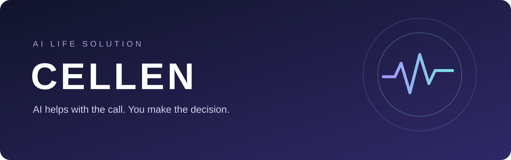
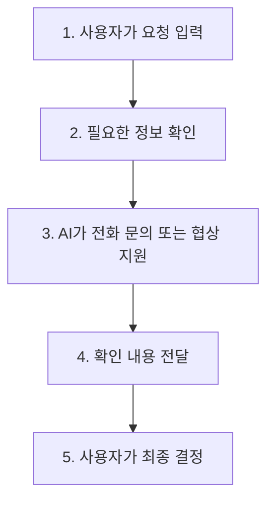
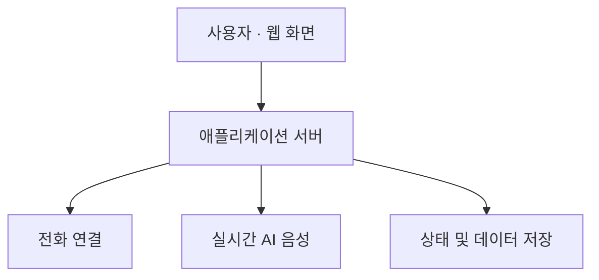

# CELLEN · AI Life Solution

**복잡하고 부담스러운 고객센터 전화, CELLEN이 함께합니다.**  
전화와 정보 확인은 AI가 돕고, 최종 결정은 사용자가 합니다.

[사이트 보기](https://ya-haejwo-brand.esm5678.chatgpt.site) · [제작자 GitHub](https://github.com/esm5678-dot)

> **현재 상태: 개발 및 검증 중인 프로토타입**  
> 사이트는 공개 주소이나 현재 접속과 모든 기능의 작동 여부는 이번에 독립적으로 확인하지 못했습니다. 실제 통화 서비스의 안정적 운영이나 업무 완료를 보장하지 않습니다.

CELLEN is an AI-assisted phone service prototype for everyday customer-service tasks. The user remains in control of consequential decisions.

## 왜 CELLEN인가요?

해지 조건을 확인하거나 환불 가능 여부를 묻는 일도 긴 대기, 반복 설명, 어려운 용어 때문에 부담스러울 수 있습니다. CELLEN은 사용자가 원하는 내용을 정리하고 필요한 정보를 확인하는 과정을 돕기 위해 만들어지고 있습니다.

| 이런 상황에서 | CELLEN이 돕고자 하는 일 |
| --- | --- |
| 서비스 해지가 부담스러울 때 | 해지 방법과 조건 확인 |
| 환불이 가능한지 궁금할 때 | 환불 조건과 절차 문의 |
| 제품에 문제가 생겼을 때 | AS 접수 방법과 필요 서류 확인 |
| 낯선 언어나 복잡한 설명이 어려울 때 | 문의 내용 정리와 의사소통 지원 |

## 사용 흐름

위 그림은 **목표로 하는 서비스 흐름**입니다. 모든 단계가 실제 환경에서 완전히 검증됐다는 뜻은 아닙니다.

## 어디까지 만들었나요?

| 영역 | 상태 | 확인 범위 |
| --- | --- | --- |
| AI 음성 연결 | 구현됐으나 추가 검증 필요 | OpenAI Realtime과 전화 연동을 위한 서버 코드가 존재합니다. 2026년 10월 6일 기록에는 실제 OpenAI와 모의 전화 음성을 이용한 통합 테스트가 있습니다. |
| 전화 연결 | 구현됐으나 추가 검증 필요 | Vonage 연동 코드가 있습니다. 위 통합 테스트는 실제 휴대폰 통화가 아니며, 안정적인 실전화 업무 수행은 별도 검증이 필요합니다. |
| 사용자 승인·결과 표시 | 구현됐으나 추가 검증 필요 | 후보 코드에 승인 및 결과 상태 처리와 관련 테스트가 있습니다. 실사용 환경의 전체 흐름은 추가 확인이 필요합니다. |
| 결과 일관성 | 구현 및 검증 완료 | 2026년 10월 21일 후보 테스트 기록에서 관련 105개 중 104개 통과, 1개 조건부 건너뜀. 외부 API와 실제 전화는 사용하지 않은 테스트입니다. |
| 외국어 상담·업무 범위 확장 | 개발 예정 | 다양한 상황에서의 품질과 실제 업무 처리 가능성을 검증할 예정입니다. |

**테스트 결과는 특정 시점과 환경의 기록입니다.** 같은 보고서의 별도 백엔드 테스트에서는 2개 실패가 있었고, 각각의 재실행에서는 통과했습니다. 시뮬레이션과 실제 전화는 다른 검증입니다.

## 기술 구성

| 기술 | 역할 |
| --- | --- |
| Node.js · Express | 요청 처리와 서버 실행 |
| WebSocket | 실시간 음성 및 이벤트 전달 |
| Vonage Voice API | 전화망 연결을 위한 연동 |
| OpenAI Realtime | 실시간 음성 대화 |
| PostgreSQL | 사례와 서비스 상태 저장 |
| Render · ChatGPT Sites | 서버 및 웹 프런트엔드 배포에 사용된 환경 |

구성은 확인된 개발 자료를 바탕으로 요약했으며, 브랜치와 배포 환경에 따라 다를 수 있습니다.

## 다음 단계

- 실제 통화에서 음성 품질, 역할 유지와 결과 전달 검증
- 해지 문의처럼 범위가 명확한 첫 사용 사례 중심으로 사용자 경험 개선
- 사용자 승인, 상담원 연결, 실패 시 복구 흐름 검증
- 공개 가능한 실제 화면과 시연 영상 확보 후 추가

## 제작 및 협업

**Lee Seung Min · CELLEN 팀**  
AI를 활용해 일상적인 업무의 부담을 줄이는 제품을 탐색합니다. 협업 문의는 [GitHub 프로필](https://github.com/esm5678-dot)을 통해 확인할 수 있습니다.

---

개발 자료 확인: 2026년 10월 30일. 원본 소스 저장소는 비공개이며, 이 페이지는 공개용 프로젝트 소개입니다.
