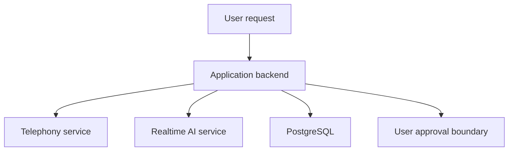

# CELLEN

**Status:** In development. The repository is private; this is a high-level project overview.

## Problem and approach
Phone-based customer service can be time-consuming. CELLEN explores AI-assisted calls for tasks such as cancellation and customer-service inquiries. The product principle is that AI can help with the conversation, while the user makes the final decision; human handoff is part of the intended workflow.

## Architecture

The private main-branch package identifies a Node.js, Express and WebSocket application with Vonage, OpenAI and PostgreSQL dependencies. Branches may differ; this diagram is a high-level overview, not a description of every runtime path.

## Evidence and limits
- Project work includes approval, cost safeguards, result consistency and recovery paths. A candidate-focused PR reported 104 passed, 0 failed and 1 conditional skip in a 105-case core test set; a separate broader run retained two failures that passed individually. That report did not perform real phone calls, SMS or paid model calls.
- A prior simulation report used mock, replay and synthetic inputs with provider traffic blocked. Simulation counts are not customer calls or a measured success rate.
- A candidate environment and a public front end were reported deployed on October 21, 2026. Their current state has not been independently checked here. Production readiness and live-call behavior require separate verification.

## Next work
Verify current live-call behavior, operational safeguards and approval flow; validate the first use case with users. Keep private code and customer information out of public documentation.
