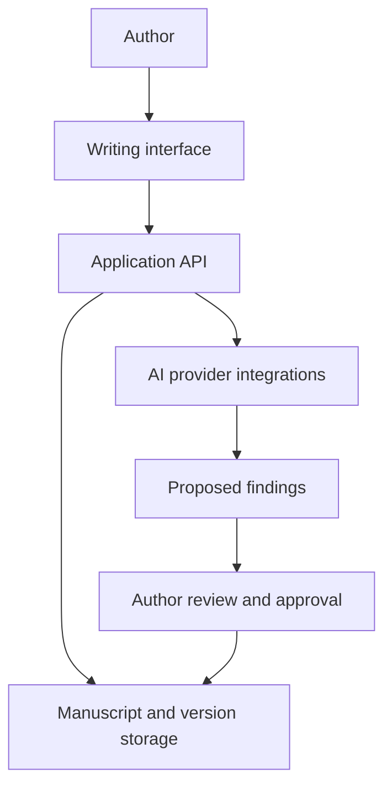

# NOVELFORGE

**Status:** In development; private beta readiness has not been established. Source is private.

## Problem and approach
Long-form fiction requires sustained consistency and careful editorial control. NOVELFORGE explores an AI-assisted workflow for drafting, editing, review, version history and author-approved changes.

## Architecture

This is a simplified workflow based on the repository's documentation and pull requests. Implementations differ across branches.

## Evidence and limits
- Repository PRs describe Python, SQLAlchemy, Alembic and PostgreSQL work, plus a Next.js interface on later branches.
- A prior live experiment reported a synthetic draft and provider-generated editing and review outputs, with changes awaiting approval. This is a scoped experiment, not proof of literary quality across full manuscripts.
- V1.3 is a draft PR built on a preview branch. The latest supplied project report says local validation was completed, but actual Render backup restoration and operational alert delivery were not verified. V1.3 was not reported deployed. These are reported results, not tests rerun for this portfolio.

## Next work
Verify backup restoration, operational alert delivery and deployment-specific security before considering a private beta. Evaluate writing quality with representative manuscripts and human reviewers.
